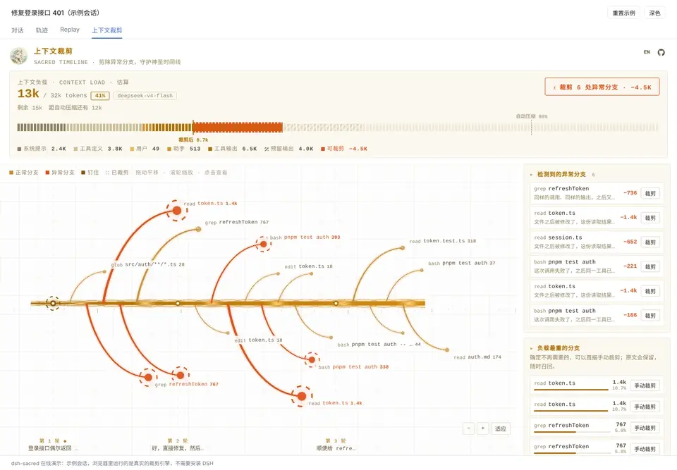
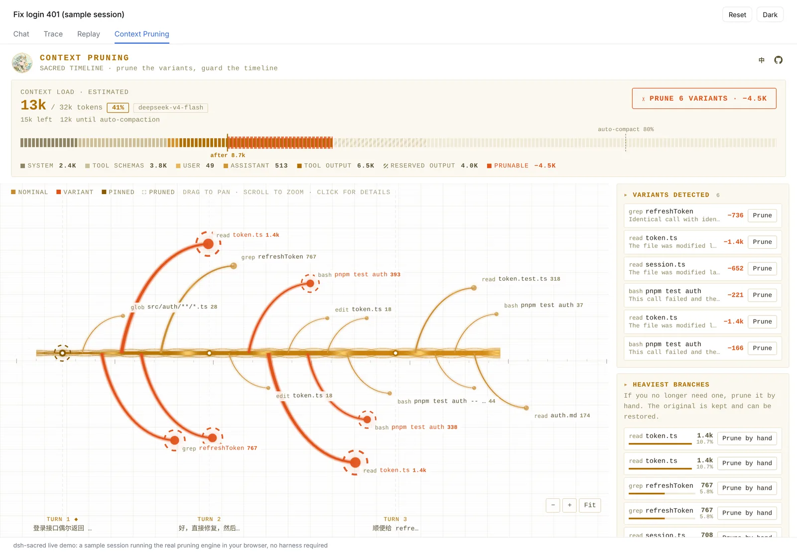
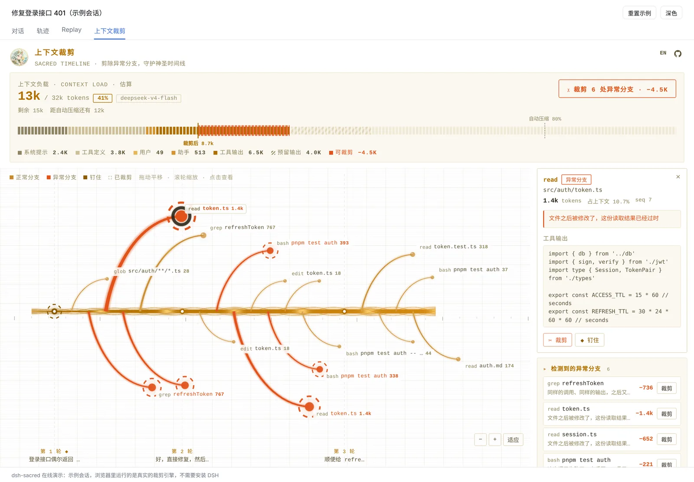
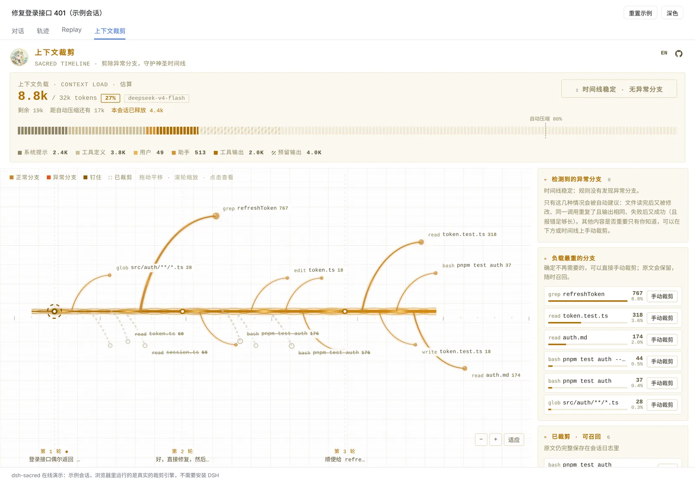
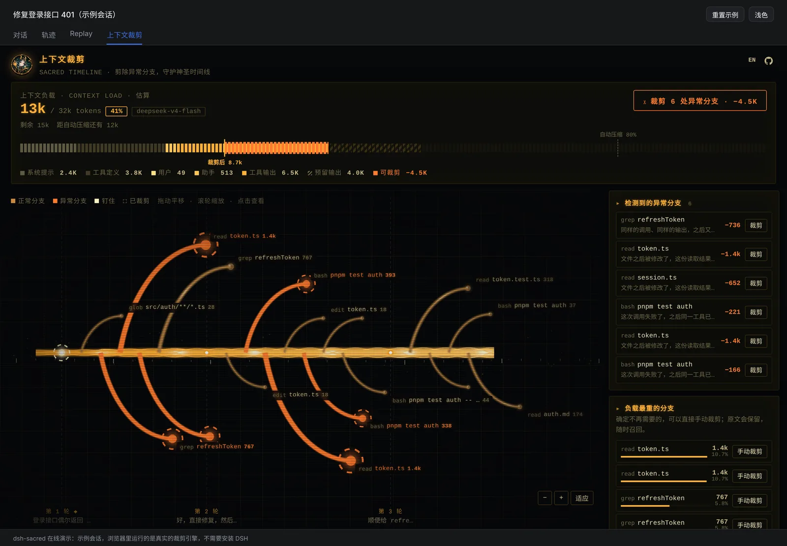
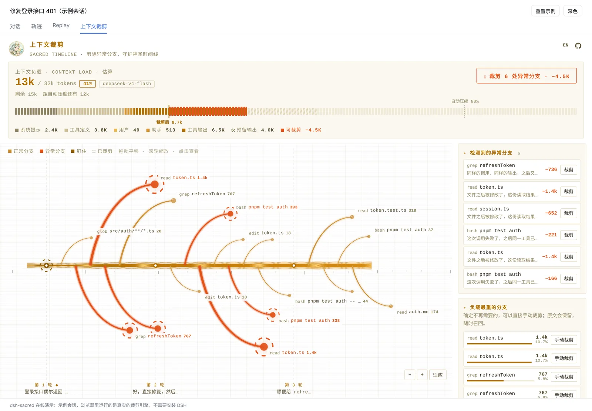
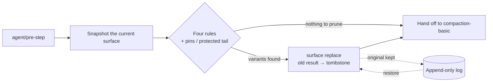

<div align="center">

<picture>
  <source media="(prefers-color-scheme: dark)" srcset="./assets/brand/logo-dark-256.webp">
  
</picture>

# dsh-sacred

[简体中文](./README.md) · English

**Prune the variants. Guard the sacred timeline.**<br/>
A context-pruning plugin for [DeepSeek Harness](https://github.com/deepseek-ai/deepseek-harness). Instead of chopping from the start when the window fills up, it removes the branches that are **no longer true or no longer useful**.<br/>
Pinned content is never pruned. Pruned content can always be restored.

[](./LICENSE)
[](https://github.com/topics/dsh-plugin)


**[Live demo](https://mingozhou.github.io/dsh-sacred/)** · [Why](#why) · [The panel](#the-context-pruning-panel) · [Install & use](#install--use) · [Commands](#commands) · [How it works](#how-it-works) · [FAQ](#faq)



</div>

---

## Why

In long sessions, an agent's context gets dragged down by three things:

| What you notice | What is actually happening | What dsh-sacred does |
|---|---|---|
| **"It went back to that wrong idea again"** | Failed attempts and long-outdated file contents stay in context and keep steering the model | Turns these **variants** into a one-line tombstone that keeps only what was tried and why it failed |
| **"It forgot what I said at the start"** | Auto-compaction cuts by age, so the earliest requirements and constraints go first | Anything you pin with `/sacred pin` is never pruned by dsh-sacred |
| **"Compaction is a black box"** | You can't tell what was lost, and you can't get it back | Every prune can be previewed, listed, and restored in one click |

A typical case: the agent reads `src/auth.ts` (3,000 lines), edits it, reads it again, edits it again. Context now holds two copies of the file that are **already wrong**. They waste tokens, and the model may keep editing against the stale version.

dsh-sacred replaces each of them with a single line:

```
⟪sacred⟫ Pruned stale branch: this read src/auth.ts output is outdated — the file was modified later (seq 142). Re-read the file if you need its current content.
```

## The Context Pruning panel

Once installed, a **Context Pruning** tab appears next to **Chat / Trace / Replay** at the top of every conversation. It is styled as a retro-futurist timeline console (monospace type, an LED-segment load meter, grid and scanlines) and **follows the DSH theme**: amber ink on white in light mode, glowing amber on black in dark mode. The UI is available in English and Chinese. It has three parts.

**1. Context load.** How many tokens the current request uses, how big the model window is, how much is left, how far you are from the auto-compaction line, and where the tokens go (system prompt / tool schemas / user / assistant / tool output). The prunable share blinks on the meter, with a marker showing where usage will land after pruning. The numbers come from DSH's own `tokenMeter` and the routed model's context window.

**2. The sacred timeline** (WebGL, zero dependencies). Time flows left to right along a braided strand. Each conversation turn is a knot on the strand; each tool call is a branch. **The strand's thickness is the context accumulated up to that moment**, and a branch's length and width are the tokens it occupies, so you can watch the timeline thin out as you prune.



- **Nominal branch** (dark amber): tool output that is still useful
- **Variant** (bright orange, flickering, dashed halo): output that is stale, duplicated, or a failure that was later retried
- **Pinned** (golden ring): a node pinned to the sacred timeline, such as the instruction that set your constraints; never pruned
- **Pruned** (a severed, drooping dashed line): the original moves to the Pruned list and can be restored

Drag to pan, scroll to zoom, hover for token counts, click for details.

**3. Side panel.** **Variants detected** (hover one to preview its effect on the meter), **Heaviest branches** (sorted by tokens; any of them can be **pruned by hand**, because only you know what is no longer important), and **Pruned** (restore anything).

Click any branch to see how many tokens it uses and why it can be pruned, with Prune / Prune by hand / Pin / Restore actions:

<table>
<tr>
<td></td>
<td></td>
</tr>
<tr>
<td align="center">A selected variant: its size and why it is stale</td>
<td align="center">After pruning: usage drops from 41% to 27%, branches droop, originals can be restored</td>
</tr>
<tr>
<td></td>
<td></td>
</tr>
<tr>
<td align="center">Dark theme: amber timeline on black</td>
<td align="center">Chinese UI</td>
</tr>
</table>

> Want to look before installing? The **[live demo](https://mingozhou.github.io/dsh-sacred/)** runs the real pruning engine in your browser on a sample session; every button works.

## How it differs from built-in compaction

DSH's own `dsh-compaction-tool-result-pruner` prunes **by length**: anything over 8,192 characters loses its middle, and only when tokens run short. dsh-sacred prunes **by value**. The two can run side by side:

| Rule | When a branch counts as a variant |
|---|---|
| `superseded-by-write` | A file that was `read` and later **successfully** changed by `write` / `edit` / `str_replace_editor` / `apply_patch` |
| `superseded-by-read` | The same file and range was read again later |
| `duplicate` | The same tool, with the same arguments and the same output, appears again later |
| `failed-retried` | A call failed and the same tool later succeeded; only the head of the error is kept as the lesson |

dsh-sacred runs **before** each model step, ahead of `dsh-compaction-basic`. Pruning the variants first often means full summarization never has to happen.

## Install & use

### Desktop app users

1. Open the DSH app and go to **Plugins** in the sidebar.
2. Search the plugin store for **`dsh-sacred`** and click **Install**.
3. Restart DSH when prompted. Open any conversation: a **Context Pruning** tab appears next to **Chat / Trace**.

### Source build users

From the root of your DeepSeek Harness checkout:

```sh
pnpm dsh plugin --profile web add dsh-sacred   # installs dsh-sacred from npm and enables it
pnpm dsh web                                   # restart
```

`dsh plugin add` runs `npm install dsh-sacred` for you and registers the plugin in the profile. Running `npm install` on its own does not enable the plugin.

If DSH is installed globally from npm, use `dsh` instead of `pnpm dsh`:

```sh
dsh plugin --profile web add dsh-sacred
```

Replace `web` with the profile you actually use (`headless`, `acp`, or a custom one). Auto mode is on by default; no configuration is needed.

### Getting started

1. **Check the load.** Open a conversation and switch to Context Pruning. The meter at the top shows tokens used, tokens left, and the distance to auto-compaction.
2. **Prune the variants in one click.** The button at the top right prunes every detected variant (stale file reads, duplicate calls, failures that were retried). Hover a suggestion in the side panel to preview how much it saves.
3. **Prune by hand.** If a tool output won't be needed again (a side question you asked mid-task, search results you've already used), select it on the timeline, or click **Prune by hand** under Heaviest branches.
4. **Pin.** Pin anything important, such as the instruction that set your constraints, and dsh-sacred will never touch it.
5. **Restore.** Pruned the wrong thing? Click **Restore** in the Pruned list and the original is back in context immediately.

You don't have to open the panel at all: auto mode prunes variants before each model step once enough have accumulated. Every action also has a [slash command](#commands).

### Linking from source (plugin developers)

To work on the plugin itself, link a local checkout:

```sh
git clone https://github.com/MingoZhou/dsh-sacred
cd dsh-sacred && npm install && npm run build

cd /path/to/deepseek-harness
pnpm dsh plugin --profile web add /absolute/path/to/dsh-sacred   # must be an absolute path
pnpm dsh web
```

After changing the plugin, run `npm run build` in the plugin directory and restart DSH.

### Troubleshooting

Open `http://127.0.0.1:3080/sacred/api/health`:

- `{"ok":true,"version":...}`: the host half is running. The `services` field shows whether `tokenMeter` / `llm` / `compaction` / `sessionController` / `agents` are available; anything missing degrades gracefully and never blocks startup.
- 404: the host half did not start (the tab may still appear, because the frontend loads separately). Check the terminal running DSH for errors mentioning `dsh-sacred`.

Compatibility: the plugin hard-requires only the `webServer` and `commands` services and reads everything else on demand. Loading has been verified on the Cordis runtime bundled with DSH 0.2.1.

## Commands

Everything in the Context Pruning tab is also available as a slash command (the command is `sacred`, without the `dsh-` prefix):

| Command | What it does |
|---|---|
| `/sacred` | Preview: what would be pruned, how much it saves, where the cache breaks |
| `/sacred prune` | Apply all suggestions now |
| `/sacred drop <seq…>` | Prune the given tool outputs by hand, regardless of the rules |
| `/sacred pin <seq>` | Pin a node; dsh-sacred will never prune it |
| `/sacred unpin <seq>` | Unpin |
| `/sacred pins` | List pinned nodes |
| `/sacred restore <seq>` | Restore an original (pass the seq of the tombstone or of the original) |
| `/sacred cut <start> <end>` | Condense a whole dead end into one summary tombstone (uses the built-in `compactRegion`; refuses if the range contains a pinned node) |

`seq` is the event's sequence number in the session log. You can find it in the Context Pruning detail panel, the DSH Trace tab, or the timeline in [dsh-replay](https://github.com/MingoZhou/dsh-replay).

## Configuration

Override in your profile's `cordis.patch.yml`:

```yaml
- id: sacred
  config:
    auto: true
    minSavingsChars: 6000
```

| Field | Default | Description |
|---|---|---|
| `auto` | `true` | Prune automatically before each model step |
| `minSavingsChars` | `6000` | In auto mode, only prune once at least this many characters can be saved (see [FAQ](#why-wait-until-enough-has-accumulated)) |
| `protectRecentToolResults` | `4` | The most recent N tool results are never touched |
| `minChars` | `200` | Outputs shorter than this are not worth replacing (failures excepted) |
| `failedKeepChars` | `400` | How much of an error a failed branch keeps as its lesson |
| `stateDir` | `$DSH_HOME/sacred` | Where pins and the prune ledger are stored |
| `routePrefix` | `/sacred/api` | HTTP prefix used by the Context Pruning tab |
| `previewChars` | `600` | Preview characters sent to the browser per node |
| `thresholdRatio` | `0.8` | Where the auto-compaction line sits on the meter; keep it in sync with `compaction-basic` |

## How it works



The DSH session log is **append-only**; what the model sees is a surface layered on top of it. Every prune follows the same protocol as the built-in pruner:

1. Append a `compaction/prune` event recording the token estimate of the replaced node (its shadow price), so token accounting stays correct;
2. Append a new `tool/result` that replaces the old result in place on the surface via `surfaceOp: replace`, pointing back to the original through `sourceEventSeqs`.

As a result:

- **Nothing is deleted**: the original always stays in the log, and replay reconstructs everything;
- **Tool call pairs stay intact**: only the result text is replaced, so every call still has its result;
- **Everything is restorable**: `restore` performs another in-place replacement that puts the original back.

## FAQ

### Could it prune something I still need?

The rules only target tool output that has been overtaken by later facts or repeated: a file that changed, a file read again, an exact duplicate, a failure that later succeeded. The 4 most recent tool results and anything pinned are never touched. If something is pruned by mistake, `/sacred restore <seq>` brings it back.

### Why wait until enough has accumulated?

Context caches at DeepSeek and other providers **match by prefix**. A cut in the middle invalidates the cache for everything after it, so frequent small prunes can cost more in cache misses than they save in tokens. Auto mode therefore waits until 6,000 characters can be saved, and the `/sacred` preview tells you where the cache will break.

### How is this different from `/compact`?

`/compact` hands older history to the model to summarize: it costs a model call, can't be undone, and doesn't show you what was dropped. dsh-sacred makes no model calls and only applies deterministic replacements that you can see and undo. They complement each other: dsh-sacred prunes the variants first, and `/compact` finishes the job when space is truly tight.

### How does it relate to dsh-replay?

[dsh-replay](https://github.com/MingoZhou/dsh-replay) is read-only and replays a run; dsh-sacred modifies the surface and prunes. The smoothest workflow is to find the seq of a loop or dead end on the Replay timeline, then cut it with `/sacred cut`.

## Known limitations

- **Pins only bind dsh-sacred.** When the built-in `compaction-basic` summarizes, pinned nodes can still end up inside the summary.
- Pins record surface seqs; if another plugin replaces a node, the pin no longer applies.
- Tools whose file paths can't be recognized, such as `bash`, only take part in the `duplicate` and `failed-retried` rules.
- This is a preview release. Host interfaces follow the `tool-result-pruner` and `compaction` contracts in the DSH 0.2.x source; reports from other versions are welcome.

## Roadmap

- [ ] **Sacred anchors**: re-inject pinned content after a full summarization
- [x] **Context Pruning panel**: context load, WebGL sacred timeline, suggestions and manual pruning, theme-aware, English and Chinese
- [ ] dsh-replay integration: prune or pin straight from its timeline
- [ ] Recognize common file reads and writes inside `bash` (`cat`, `sed -i`, …)
- [ ] An optional LLM-judged rule for semantic variants, such as approaches the user rejected

## Development

```sh
git clone https://github.com/MingoZhou/dsh-sacred
cd dsh-sacred
npm install
npm test             # rule engine + simulated session + HTTP API tests
npm run typecheck
npm run build        # lib/index.js (host) · lib/client.js (Context Pruning panel) · demo/dist/demo.js
npx serve demo       # open the demo locally
npm run screenshots  # regenerate README screenshots and the gif (needs npx playwright install chromium)
```

Layout:

```
src/
  core/        pure functions: pruning rules and the tree model, no DSH dependency
  engine.ts    SacredEngine: prune / pin / restore, shared by the host, the HTTP API and the demo
  index.ts     host plugin: slash command, pre-step hook, HTTP API
  store.ts     pins and the prune ledger (file storage)
  client/      the Context Pruning tab (React)
    timeline/  the sacred timeline: layout (pure) + WebGL renderer (zero-dependency shaders)
demo/          GitHub Pages demo: the real engine running on a sample session
tests/
```

Pushing to `main` builds and publishes the demo through `.github/workflows/pages.yml` (the first time, set Settings → Pages → Source to GitHub Actions).

Brand assets live in `assets/brand/` (round transparent logos, light and dark) and share images in `assets/social/`: upload `og-light.png` under Settings → Social preview to use it as the link preview; `xhs-cover.png` is a 3:4 portrait cover. Regenerate with `node scripts/brand.mjs <dark source> <light source>` and `node scripts/social.mjs`.

To add a rule, implement it in `src/core/rules.ts` and add cases to `tests/rules.test.ts`. PRs welcome.

## Acknowledgements

- Inspired by the Sacred Timeline and branch pruning in the TV series *Loki*. This project is not affiliated with Marvel or Disney.
- The pruning protocol follows DeepSeek Harness's built-in `dsh-compaction-tool-result-pruner`.

## License

[MIT](./LICENSE) © MingoZhou
