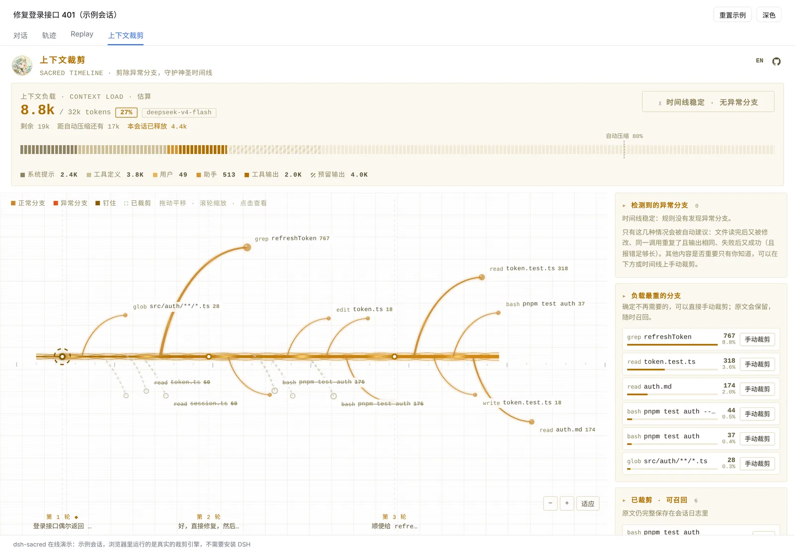
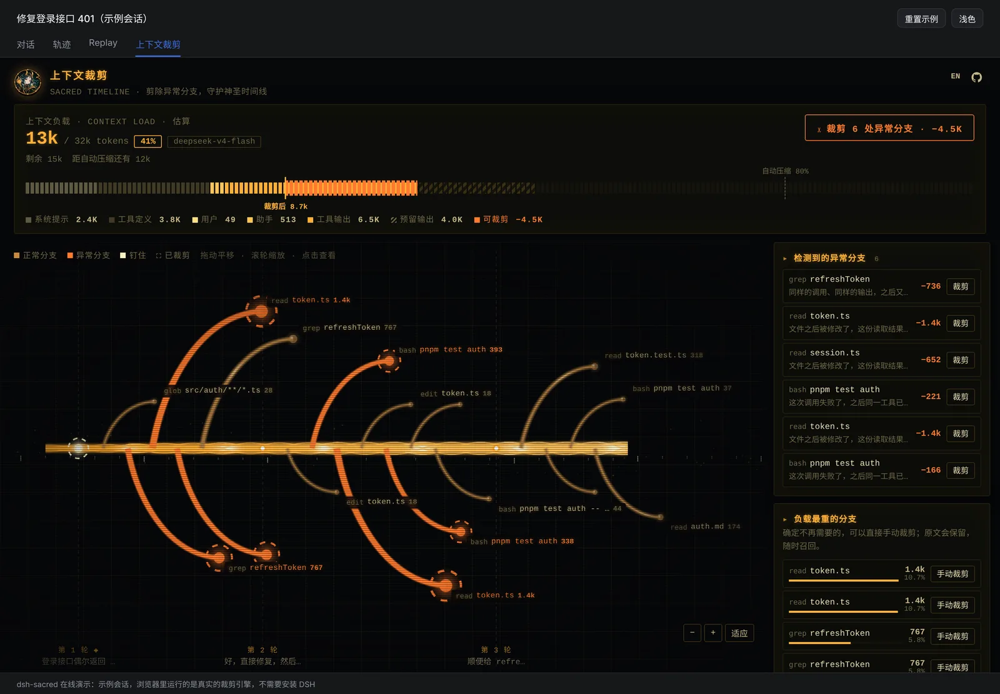
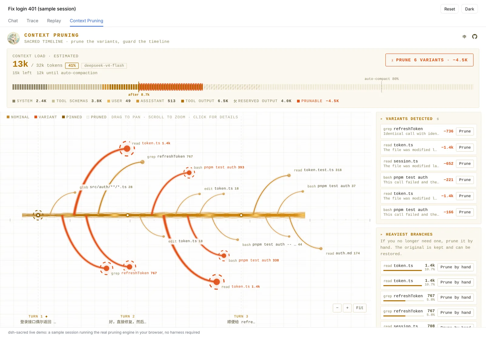
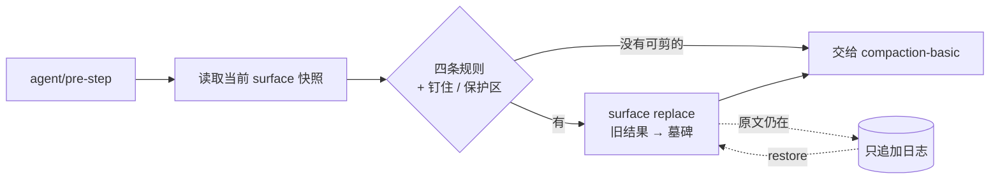

<div align="center">

<picture>
  <source media="(prefers-color-scheme: dark)" srcset="./assets/brand/logo-dark-256.webp">
  
</picture>

# dsh-sacred

简体中文 · [English](./README.en.md)

**剪除异常分支，守护神圣时间线。**<br/>
给 [DeepSeek Harness](https://github.com/deepseek-ai/deepseek-harness) 用的上下文修剪插件：不是“满了就从头砍”，而是剪掉已经**不再真实、不再有用**的分支。<br/>
钉住的永不剪，剪掉的随时召回。

[](./LICENSE)
[](https://github.com/topics/dsh-plugin)


**[在线 Demo](https://mingozhou.github.io/dsh-sacred/)** · [为什么需要它](#为什么需要它) · [上下文裁剪面板](#上下文裁剪面板) · [安装与使用](#安装与使用) · [命令](#命令) · [工作原理](#工作原理) · [常见问题](#常见问题)


</div>

---

## 为什么需要它

长会话里，Agent 的上下文会被三类东西拖垮：

| 你遇到的 | 真正的原因 | dsh-sacred 怎么做 |
|---|---|---|
| **“它又绕回那个错误思路了”** | 失败的尝试、早已过时的文件内容一直留在上下文里，模型反复被它们带偏 | 把这些**异常分支**剪成一行墓碑，只留“试过什么、为什么不行” |
| **“它忘了我一开始说的”** | 自动压缩按时间先后砍，最早定下的需求和约束最先被挤掉 | `/sacred pin` 钉住的节点，dsh-sacred 永不剪除 |
| **“压缩是个黑箱”** | 不知道丢了什么，也找不回来 | 每次剪除都可预览、可列出、可一键召回 |

一个典型的场景：Agent 读了 `src/auth.ts`（3000 行），改了它，又读了一遍，又改了一遍。此时上下文里躺着两份**已经是错的**旧文件内容。它们不只是浪费 token，模型还可能照着旧内容继续改。

dsh-sacred 会把它们换成这样一行：

```
⟪sacred⟫ Pruned stale branch: this read src/auth.ts output is outdated — the file was modified later (seq 142). Re-read the file if you need its current content.
```

## 上下文裁剪面板

安装后，会话顶部的 **对话 / 轨迹 / Replay** 旁边会多出一个 **「上下文裁剪」**（英文界面为 Context Pruning）标签页。界面是复古未来主义的「时间线管理终端」风格：等宽字体、LED 分段负载条、网格与扫描线；**跟随 DSH 主题**——浅色是白底暗琥珀时间线，深色是黑底发光的琥珀时间线；支持中英文切换。它由三部分组成：

**1. 上下文负载**：当前请求用了多少 tokens、模型窗口多大、还剩多少、离自动压缩线还有多远，以及这些 tokens 花在哪里（系统提示 / 工具定义 / 用户 / 助手 / 工具输出）。可裁剪的部分会在负载条上闪烁标出，并显示「裁剪后」会降到多少。数据来自 DSH 自己的 `tokenMeter` 与当前模型的窗口信息。

**2. 神圣时间线**（WebGL 渲染，零依赖）：时间从左到右流动，主线由多股细线编织而成；每一轮对话是主线上的一个节点，每次工具调用是一根分支。**主线的粗细就是到那一刻为止累积的上下文**，分支的长短粗细就是它占用的 tokens，裁剪之后能直接看到时间线变细。


- **正常分支**（暗琥珀）：仍然有用的工具输出
- **异常分支**（亮橙、闪烁、带虚线光环）：已过时、重复或失败重试的输出
- **钉住**（金色光环）：钉入神圣时间线的节点（比如定下约束的那条指令），永不裁剪
- **已裁剪**（断开垂落的虚线）：原文进入「已裁剪」列表，随时召回

拖动平移、滚轮缩放、悬停看 tokens，点击查看详情。

**3. 侧栏**：**检测到的异常分支**（悬停可在负载条上预览效果）、**负载最重的分支**（按 tokens 排序，任何一条都可以**手动裁剪**——哪些内容不重要，最终由你决定）、**已裁剪**（随时召回）。

点击任意分支，右侧会说明它占多少 tokens、为什么可以裁剪，并给出裁剪 / 手动裁剪 / 钉住 / 召回按钮：

<table>
<tr>
<td></td>
<td></td>
</tr>
<tr>
<td align="center">选中一根可裁剪的分支：占多少、为什么过时</td>
<td align="center">裁剪之后：用量从 41% 降到 27%，分支垂落，原文可召回</td>
</tr>
<tr>
<td></td>
<td></td>
</tr>
<tr>
<td align="center">深色主题：黑底琥珀时间线</td>
<td align="center">English UI</td>
</tr>
</table>

> 不想装插件也能先看看：**[在线 Demo](https://mingozhou.github.io/dsh-sacred/)** 在浏览器里运行的是真实的剪除引擎，示例会话里的按钮都能点。界面支持中文和英文。

## 和官方压缩有什么不同

DSH 自带的 `dsh-compaction-tool-result-pruner` **按长度**剪：超过 8192 字符就砍掉中间，并且只在 token 吃紧时才触发。dsh-sacred **按价值**剪，二者可以同时启用：

| 规则 | 什么时候算“异常分支” |
|---|---|
| `superseded-by-write` | `read` 过的文件，之后被 `write` / `edit` / `str_replace_editor` / `apply_patch` **成功**修改了 |
| `superseded-by-read` | 同一个文件、同一个范围，之后又读了一次 |
| `duplicate` | 同一个工具、同样的参数、同样的输出，后面又出现了一次 |
| `failed-retried` | 调用失败，之后同一个工具成功了。只保留报错开头，作为“教训” |

dsh-sacred 在每一步请求模型**之前**运行，并且排在 `dsh-compaction-basic` 前面：先剪掉异常分支，很多时候就用不着触发整段摘要了。

## 安装与使用

### 桌面客户端用户

1. 打开 DSH 客户端，进入左侧的 **插件**。
2. 在插件商店里搜索 **`dsh-sacred`**，点击 **安装**。
3. 按提示重启 DSH。打开任意会话，顶部 **对话 / 轨迹** 旁边会出现 **「上下文裁剪」** 标签页。

### 源码版本用户

在 DeepSeek Harness 仓库根目录执行：

```sh
pnpm dsh plugin --profile web add dsh-sacred   # 从 npm 安装 dsh-sacred 并启用
pnpm dsh web                                   # 重启
```

`dsh plugin add` 会帮你完成 `npm install dsh-sacred`，并把插件写进 profile。只单独执行 `npm install` 不会启用插件。

用 npm 全局安装 DSH 的用户，把 `pnpm dsh` 换成 `dsh` 即可：

```sh
dsh plugin --profile web add dsh-sacred
```

把 `web` 换成你实际使用的 profile（`headless`、`acp` 或自定义）。安装后默认开启自动模式，不需要额外配置。

### 开始使用

1. **看负载**：打开一个会话，切到「上下文裁剪」。顶部的负载条显示当前用了多少 tokens、还剩多少、离自动压缩还有多远。
2. **一键裁剪异常分支**：右上角按钮会裁掉所有检测到的异常分支（过时的文件读取、重复调用、失败后重试）。在侧栏的建议上悬停，可以先在负载条上预览能省多少。
3. **手动裁剪**：觉得哪段工具输出以后用不上（比如中途问的一个题外话、已经用完的搜索结果），在时间线上点中它，或在侧栏「负载最重的分支」里点 **手动裁剪**。
4. **钉住**：重要的内容（比如开头定下约束的那条指令）点 **钉住**，dsh-sacred 永远不会动它。
5. **召回**：剪错了，在「已裁剪」列表里点 **召回**，原文立即回到上下文。

不打开面板也没关系：自动模式会在每一步请求模型之前，把攒够一定量的异常分支剪掉。所有操作也都有对应的[斜杠命令](#命令)。

### 从源码链接（插件开发者）

想修改插件本身时，用本地路径链接安装：

```sh
git clone https://github.com/MingoZhou/dsh-sacred
cd dsh-sacred && npm install && npm run build

cd /path/to/deepseek-harness
pnpm dsh plugin --profile web add /absolute/path/to/dsh-sacred   # 必须是绝对路径
pnpm dsh web
```

之后改了插件代码，在插件目录重新 `npm run build`，再重启 DSH 即可。

### 排查

打开 `http://127.0.0.1:3080/sacred/api/health`：

- 返回 `{"ok":true,"version":...}`：插件宿主部分已启动。`services` 字段会列出 `tokenMeter` / `compaction` / `sessionController` / `agents` 是否可用，缺少的能力会自动降级，不会影响启动。
- 返回 404：宿主部分没有启动（标签页仍可能出现，因为前端是单独加载的）。请查看启动 DSH 的终端里与 `dsh-sacred` 相关的报错。

兼容性：插件只强制依赖 `webServer` 和 `commands` 两个服务，其余能力按需读取，已在 DSH 0.2.1 自带的 Cordis 上实测加载。

## 命令

除了「上下文裁剪」标签页，所有操作也都可以用斜杠命令完成（命令名是 `sacred`，不带 `dsh-` 前缀）：

| 命令 | 作用 |
|---|---|
| `/sacred` | 预览：会剪哪些、能省多少、缓存从哪里开始失效 |
| `/sacred prune` | 立即执行全部裁剪建议 |
| `/sacred drop <seq…>` | 手动裁剪指定的工具输出（不受规则限制） |
| `/sacred pin <seq>` | 钉住一个节点，dsh-sacred 永不剪除 |
| `/sacred unpin <seq>` | 取消钉住 |
| `/sacred pins` | 列出已钉住的节点 |
| `/sacred restore <seq>` | 召回原文（传墓碑或原节点的 seq 都可以） |
| `/sacred cut <start> <end>` | 把一整段死胡同收束成一块摘要墓碑（调用官方 `compactRegion`，区间内有钉住的节点时会拒绝） |

`seq` 是事件在会话日志里的序号，在「上下文裁剪」详情面板、DSH 的【轨迹】页或 [dsh-replay](https://github.com/MingoZhou/dsh-replay) 的时间线里都能看到。

预览输出示例：

```
可剪除 3 个异常分支，节省约 41207 字符：
  seq 18  superseded-by-write read src/auth.ts  31840→146 字符
  seq 37  duplicate           grep              6120→118 字符
  seq 55  failed-retried      bash              3911→512 字符
缓存代价：从第 18/96 个节点起前缀缓存失效。运行 /sacred prune 执行。
```

## 配置

在 profile 的 `cordis.patch.yml` 里覆盖：

```yaml
- id: sacred
  config:
    auto: true
    minSavingsChars: 6000
```

| 字段 | 默认值 | 说明 |
|---|---|---|
| `auto` | `true` | 每步请求前自动修剪 |
| `minSavingsChars` | `6000` | 自动模式下，攒够这么多可节省的字符才剪（见[常见问题](#为什么要攒够了才剪)） |
| `protectRecentToolResults` | `4` | 最近 N 个工具结果永远不动 |
| `minChars` | `200` | 短于此长度的输出不值得替换（失败调用除外） |
| `failedKeepChars` | `400` | 失败分支保留多少字符的报错作为教训 |
| `stateDir` | `$DSH_HOME/sacred` | 钉住列表和剪除账本的存放目录 |
| `routePrefix` | `/sacred/api` | 「上下文裁剪」标签页使用的 HTTP 接口前缀 |
| `previewChars` | `600` | 每个节点发送给浏览器的预览字符数 |
| `thresholdRatio` | `0.8` | 用量条上「自动压缩」线的位置，与 `compaction-basic` 的配置保持一致 |

## 工作原理



DSH 的会话日志**只追加、不删除**；模型实际看到的是日志之上的一层 surface。dsh-sacred 的每次剪除都遵循和官方 pruner 一样的协议：

1. 追加一条 `compaction/prune` 事件，记下被替换节点的 token 估算（影子价格），保证 token 统计正确；
2. 追加一条新的 `tool/result`，用 `surfaceOp: replace` 在 surface 上原位替换旧结果，并用 `sourceEventSeqs` 指回原文。

所以：

- **不删任何东西**：原文始终在日志里，replay 可以完整复原；
- **不拆工具调用对**：只替换工具结果的文本，调用和结果仍然一一配对；
- **可以召回**：`restore` 再做一次原位替换，把原文换回来。

## 常见问题

### 会不会把我需要的内容剪掉？

规则只针对“已经被后来的事实推翻或重复”的工具输出：文件被改过、被重读过、完全重复、失败后已成功。最近 4 个工具结果永远不动，钉住的节点永远不动。万一剪错了，`/sacred restore <seq>` 召回即可。

### 为什么要攒够了才剪？

DeepSeek 等服务商的上下文缓存是**按前缀命中**的。在中间某个位置剪一刀，这个位置之后的缓存全部失效。频繁地小剪，缓存损失可能比省下的 token 还多。所以自动模式默认攒够 6000 字符才动手，`/sacred` 预览也会告诉你缓存从哪里开始失效。

### 和 `/compact` 有什么区别？

`/compact` 把较早的整段历史交给模型写一份摘要：要调用模型、不可逆，而且你看不到具体丢了什么。dsh-sacred 不调用模型，只做确定性的规则替换，每一处剪除都能看见、能撤销。两者互补：dsh-sacred 先剪掉异常分支，真正吃紧时再由 `/compact` 收尾。

### 和 dsh-replay 是什么关系？

[dsh-replay](https://github.com/MingoZhou/dsh-replay) 只读，负责复盘一次运行；dsh-sacred 会修改 surface，负责主动修剪。在 Replay 的时间线里找到死循环或死胡同的 seq，再用 `/sacred cut` 剪掉，是最顺手的用法。

## 已知限制

- **钉住只约束 dsh-sacred 自己**。官方 `compaction-basic` 做整段摘要时，钉住的节点仍可能被压进摘要。
- 钉住记录的是 surface seq；节点如果被其他插件替换，钉住会失效。
- `bash` 等无法识别文件路径的工具只参与 `duplicate` 和 `failed-retried` 两条规则。
- 当前为预览版：宿主接口依据 DSH 0.2.x 源码中 `tool-result-pruner` 与 `compaction` 的契约编写，欢迎在不同版本上反馈问题。

## 路线图

- [ ] **神圣锚点**：整段摘要发生后，把钉住的内容重新注入上下文
- [x] **上下文裁剪面板**：上下文用量、WebGL 神圣时间线、裁剪建议与手动裁剪，跟随主题、支持中英文
- [ ] 与 dsh-replay 联动：在时间线上一键剪除 / 钉住
- [ ] 识别 `bash` 中常见的文件读写（`cat`、`sed -i` 等）
- [ ] 可选的 LLM 判断规则：识别“被用户否决的方案”这类语义级异常分支

## 开发

```sh
git clone https://github.com/MingoZhou/dsh-sacred
cd dsh-sacred
npm install
npm test             # 规则引擎 + 模拟会话 + HTTP 接口测试
npm run typecheck
npm run build        # lib/index.js（宿主）· lib/client.js（上下文裁剪面板）· demo/dist/demo.js
npx serve demo       # 本地打开 demo
npm run screenshots  # 重新生成 README 截图和动图（需要 npx playwright install chromium）
```

目录结构：

```
src/
  core/        纯函数：裁剪规则、树状布局模型，不依赖 DSH
  engine.ts    SacredEngine：剪除 / 钉住 / 召回，宿主、HTTP 接口和 demo 共用
  index.ts     宿主插件：斜杠命令、pre-step 钩子、HTTP 接口
  store.ts     钉住列表与剪除账本（文件存储）
  client/      「上下文裁剪」标签页（React）
    timeline/  神圣时间线：布局（纯函数）+ WebGL 渲染器（零依赖着色器）
demo/          GitHub Pages 演示：在浏览器里跑真实引擎的示例会话
tests/
```

推送到 `main` 后，`.github/workflows/pages.yml` 会自动构建并发布 demo（首次需要在仓库 Settings → Pages 里把 Source 设为 GitHub Actions）。

品牌素材在 `assets/brand/`（圆形透明 logo，浅色 / 深色各一套），分享图在 `assets/social/`：`og-light.png` 可上传到仓库 Settings → Social preview，作为链接预览图；`xhs-cover.png` 是 3:4 的竖版封面。重新生成：`node scripts/brand.mjs <深色原图> <浅色原图>`、`node scripts/social.mjs`。

新增一条规则，只需要在 `src/core/rules.ts` 里实现，再在 `tests/rules.test.ts` 里补上用例。欢迎 PR。

## 致谢

- 灵感来自美剧《洛基》中“神圣时间线”与剪除分支的设定。本项目与漫威、迪士尼无任何关联。
- 剪除协议参考了 DeepSeek Harness 官方的 `dsh-compaction-tool-result-pruner`。

## License

[MIT](./LICENSE) © MingoZhou
